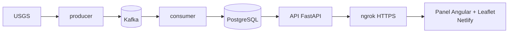
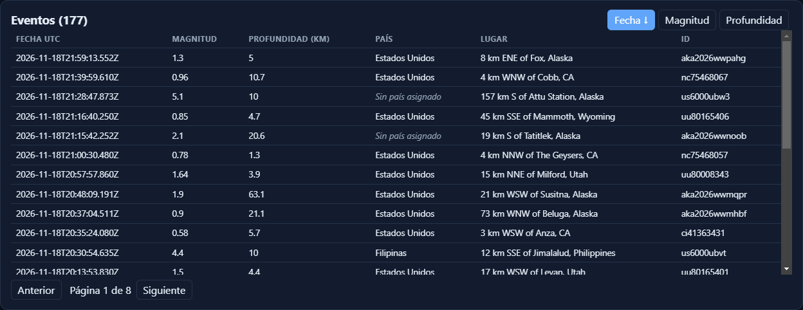
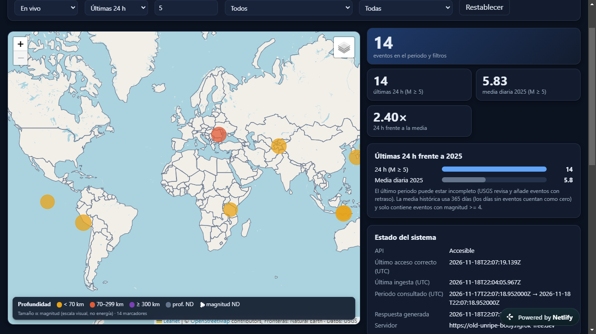
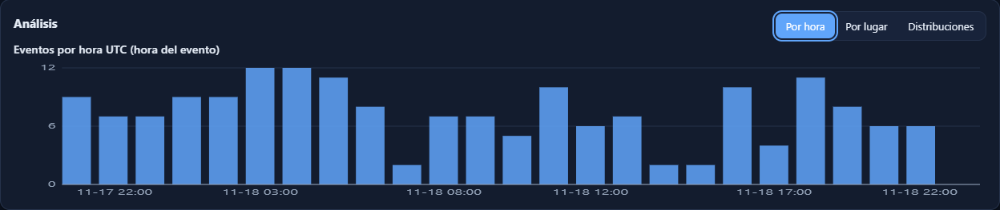
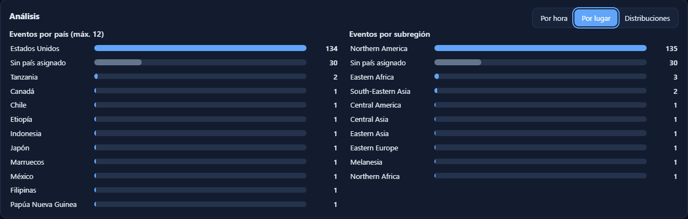
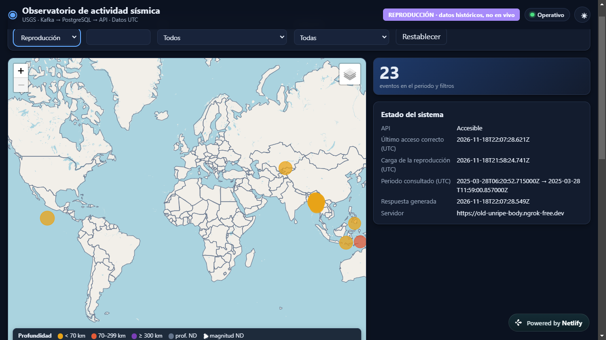
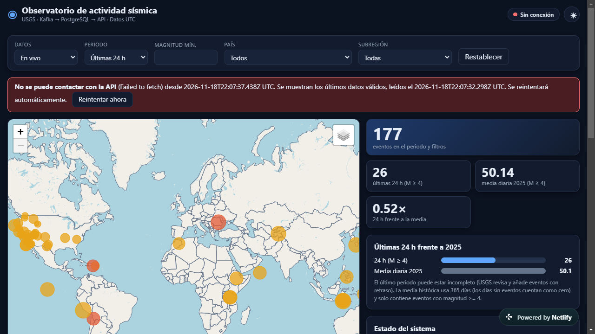
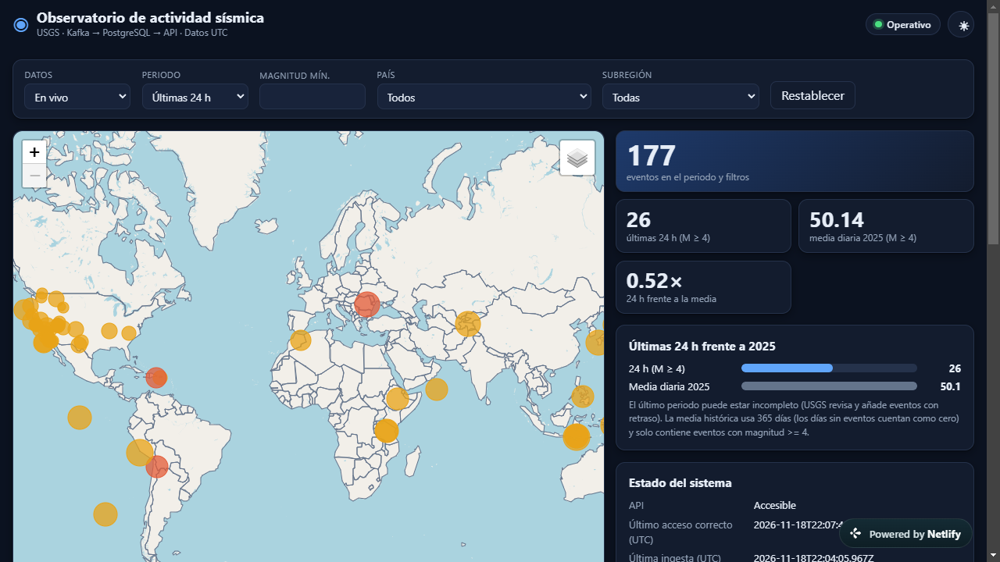

# Observatorio de actividad sísmica

**Sistemas de Big Data · RA1 · Adrián Romero**

Panel publicado: <https://adrian-observatorio-sismico.netlify.app>


> Esta página está pensada como presentación: una idea por diapositiva.

---

## 1 · El reto

**¿Dónde se registra actividad sísmica y cómo se compara con un periodo histórico equivalente?**

- Tres fuentes: **feed en vivo** (USGS), **histórico 2025** (USGS) y **catálogo de países** (Natural Earth)
- Extracción automática, calidad, integración geográfica, modelado, análisis y reflexión
- Todo reproducible con un solo comando: `docker compose up --build -d`

---

## 2 · Arquitectura



- **5 servicios Docker** obligatorios: producer · kafka · consumer · postgres · api
- ngrok y Netlify: acceso público HTTPS al panel
- Sin infraestructura extra: Python + SQL

---

# EXTRACCIÓN

## 3 · Tres fuentes, automatizadas

| Fuente | Cómo | Resultado |
|---|---|---|
| Feed `all_day.geojson` | Productor cada 60 s | Solo se publican versiones nuevas |
| Histórico 2025 (FDSN) | Un mes por consulta | **18.302 eventos** M≥4 · 12 consultas |
| Catálogo Natural Earth | GeoJSON de 110 m | **177 países**, `ADM0_A3` único |

- Feed = ventana móvil de 24 h → se compara `id` + `updated` con un **estado persistente**
- Histórico: si un mes llega a 20.000, **se biseca**, nunca se trunca en silencio
- Reejecución **sin red**: 12/12 consultas reutilizadas

---

## 4 · Robustez y procedencia

- Reintentos con espera progresiva (20 s, 40 s) · timeout · HTTP 429/5xx · JSON inválido
- Se marca como publicado **solo tras la confirmación de Kafka**
- Se guarda **cada sondeo** (estado, latencia, nº de features), cada **descarte con motivo** y el **GeoJSON original** (deduplicado por hash)
- Cada consulta histórica: URL, parámetros, estado HTTP, nº de registros, fecha, SHA-256

```
Acquired 18302 unique events from 12 queries (0 executed, 12 reused).
```

---

## 5 · Análisis de tipos y unidades

| Campo | Tipo | Unidad | ¿Falta? | Tratamiento |
|---|---|---|---|---|
| `id` | texto | — | no | clave del evento |
| `time` / `updated` | entero | ms Unix UTC | no | `time` ≠ `updated` ≠ ingesta |
| `mag` | número | según `magType` | **sí** | se conserva nulo → «ND», nunca 0 |
| `coordinates` | [lon, lat, prof] | grados · **km** | no | validadas |
| `type` | texto | — | no | solo `earthquake` |
| `place` | texto | — | sí | **no** se usa para el país |

---

# CALIDAD

## 6 · Antes y después

| | Valor |
|---|---:|
| Features recibidas del feed (26 sondeos) | **4.941** |
| Eventos distintos / versiones distintas | **190 / 197** |
| Excluidas (no son terremotos) | 78 |
| En PostgreSQL: eventos actuales / versiones | 190 / 197 |
| En cuarentena | 0 |

**El feed repite cada evento en cada sondeo → se deduplica por versión `(id, updated)`.**

---

## 7 · Las seis dimensiones

| Dimensión | Resultado | Acción |
|---|---|---|
| Completitud | sin país: 16,3 % vivo · 78,4 % histórico | «Sin país asignado» ≠ error |
| Unicidad | 0 duplicados | clave única + `ON CONFLICT` |
| Validez | 0 violaciones en el estado actual | cuarentena **antes** de guardar |
| Consistencia | 0 estados desfasados | una versión antigua nunca sustituye a la actual |
| Actualidad | sondeo USGS: mediana 104 ms · p95 125 ms | aviso a los 15 min |
| Exactitud | **71,6 %** de coincidencia con `place` | limitación del catálogo de 110 m |

---

## 8 · Decisiones de calidad

- **No se imputa 0** a un nulo: *desconocido no es cero*
- Un evento marino **no** se atribuye al país más cercano
- Magnitud o profundidad negativas **no** se rechazan por serlo
- Casos dañados de prueba: separados e identificados



---

# MODELADO

## 9 · Integración geográfica

- **Punto en polígono** con Shapely + `STRtree` → O(log n) por punto
- Regla determinista:
  - el **borde cuenta** como dentro (`covers`)
  - varias coincidencias → **menor `ADM0_A3`** + bandera `geo_ambiguous`
  - ninguna → país nulo = **«Sin país asignado»**
- `ADM0_A3`, no `ISO_A3` (vale `-99` en varias entidades)

---

## 10 · Modelo de datos

| Tabla | Una fila por… | Clave |
|---|---|---|
| `current_events` | evento (versión actual) | `event_id` |
| `event_versions` | cada revisión | `(event_id, updated)` |
| `dim_country` · `dim_date` | país · fecha UTC | `country_id` · `date_key` |
| `quarantine_records` | mensaje rechazado | `(topic, partition, offset)` |
| `replay.*` | copia aislada de la reproducción | igual |

Más: `poll_log`, `poll_exclusions`, `raw_payloads`, `extraction_queries`, `historical_events`

---

## 11 · Idempotencia y revisiones

| Mensaje | Eventos actuales | Versiones |
|---|---:|---:|
| E1 · 10:05 · mag 4,2 | 1 | 1 |
| E1 · 10:05 repetido | 1 | 1 |
| E1 · 10:09 · mag 4,6 | 1 | 2 |
| E1 · 10:05 llega tarde | 1 | 2 |
| E2 · 10:12 | **2** | 3 |

`UPDATE` solo si `EXCLUDED.updated > actual.updated` · transacción → **después** se confirma el offset de Kafka

---

## 12 · Índices (medidos)

- `current_events(time_utc)` · `(country_id, time_utc)` · `(mag)`
- Los agregados salen de `current_events` → **cuentan eventos, no mensajes**

| 1,8 M de filas | Tiempo por búsqueda |
|---|---:|
| Con índice B-tree | ≈ 0,2 ms |
| Sin índice | ≈ 50–90 ms |

---

# ANÁLISIS

## 13 · El panel


- Mapa: **tamaño = magnitud · color = profundidad · ND visible**
- Estado: última ingesta, periodo, aviso de datos antiguos
- Tabla accesible enlazada con el mapa

---

## 14 · Filtros coherentes

<table>
<tr>
<td><b>Sin filtro</b><br></td>
<td><b>Magnitud ≥ 5</b><br></td>
</tr>
</table>

Mapa · recuento · gráficos · tabla · **media histórica** cambian a la vez

---

## 15 · Ventanas, países y distribuciones





- Ventanas fijas de **1 hora UTC** por hora del evento (con horas vacías)
- «Sin país asignado» incluido · distribuciones con registros **sin valor**

---

## 16 · Comparación histórica equivalente

**Últimas 24 h vs. media diaria de 2025 — mismos filtros, misma magnitud mínima**

- Media 2025 = 18.302 / **365 días** (los días con cero cuentan)
- Con M ≥ 4: 26 eventos frente a 50,1 al día → **0,52×**
- Con M ≥ 5: 14 frente a 5,8 → **2,40×**
- Aviso: el último periodo puede estar incompleto

---

## 17 · Tres conclusiones (2025 · M ≥ 4 · mundo)

1. **Una secuencia domina el año**: julio +76 % sobre la media mensual; el 30 de julio, **645 eventos = 12,9×** la media diaria (Kamchatka M 8,8)
2. **Gutenberg-Richter**: M≥4 18.302 → M≥5 2.129 → M≥6 145 → M≥7 16 → M≥8 1 (÷ ≈ 10 por unidad)
3. **Sismicidad marina y superficial**: 78,4 % sin país · mediana 20,9 km · 74,8 % < 70 km

---

# REFLEXIÓN

## 18 · Complejidad (medida en 3 tamaños)

| Operación | Coste | 1,8 M filas |
|---|---|---:|
| Diccionario por `id` | O(1) | 0,04 µs |
| Recorrido de lista | O(n) | 21 ms |
| PostgreSQL con índice | O(log n) | 0,2 ms |
| PostgreSQL sin índice | O(n) | 50–90 ms |
| `GROUP BY` completo | O(n) siempre | 150 ms |

Filas sintéticas marcadas y **aisladas** del análisis real

---

## 19 · ¿Y con 100 millones de filas?

- Sin índice: segundos por consulta · el diccionario no cabe en RAM
- Con índice: sigue en milisegundos
- El `GROUP BY` completo (~8 s) pide **pre-agregar**
- Solución **sin nueva infraestructura**: partición mensual · índice BRIN en el tiempo · tabla de agregados por hora y país · réplicas de lectura

---

## 20 · Costes

- Toda la pila: **≈ 0,85 GiB** de RAM (Kafka, la mitad) · base de datos: **14 MB**
- Lo que más crece: payloads originales (≈ 46 MB/día) → **retención 7 días + hash**
- Cuota gratuita ≠ coste cero: electricidad, mantenimiento y tiempo de desarrollo

---

## 21 · Limitaciones y mejoras

| Limitación | Mejora propuesta |
|---|---|
| Catálogo de 110 m (71,6 % de exactitud) | Catálogo de 50 m |
| Eventos retirados fuera del feed | Reconciliación periódica con el catálogo |
| Revisiones tardías de USGS | Re-sincronizar la ventana más reciente |
| Funciona solo con equipo y túnel encendidos | Hosting permanente |
| Una sola máquina de medida | Pruebas con más carga |

---

# PRUEBAS Y DEMOSTRACIÓN

## 22 · Las 11 pruebas de aceptación

| # | Prueba | # | Prueba |
|---|---|---|---|
| 1 | Evento nuevo | 7 | Evento marítimo |
| 2 | Misma versión repetida | 8 | Reinicio del consumidor |
| 3 | Versión posterior | 9 | Túnel cerrado |
| 4 | Versión antigua después | 10 | Túnel reabierto |
| 5 | Magnitud nula → ND | 11 | Reproducción histórica |
| 6 | Coordenadas inválidas → cuarentena | | **11 / 11 cubiertas** |

**115** tests de backend (PostgreSQL real) · **6** unitarios · **9** e2e

---

## 23 · Reproducción histórica



- Topic y esquema **separados** · etiqueta **REPRODUCCIÓN**
- 25 mensajes (23 eventos + 1 duplicado + 1 revisión antigua) → **23 eventos únicos**
- Los datos en vivo **no cambian**

---

## 24 · Caída y vuelta del túnel

<table>
<tr>
<td><b>Túnel cerrado</b><br></td>
<td><b>Recuperado solo</b><br></td>
</tr>
</table>

- Banner de fallo con la **última lectura conservada** y su hora
- Sondeo serializado (nunca dos peticiones a la vez) · recuperación automática
- Si cae PostgreSQL: la API responde **503**, el productor sigue

---

## 25 · Despliegue

- **Docker Compose**: 5 servicios + perfil `tunnel` (ngrok)
- **Netlify**: solo el panel Angular · `netlify.toml` en la raíz
- **CORS** por origen exacto · sin rutas de administración · Kafka y PostgreSQL no expuestos
- **Secretos** solo en `.env` (fuera de Git)

---

## 26 · Ejecutarlo

```bash
cp .env.example .env     # POSTGRES_PASSWORD, CORS_ALLOWED_ORIGINS, NGROK_AUTHTOKEN
docker compose --profile tunnel up --build -d
docker compose run --rm -v "<ruta>/backend/data:/app/data" producer \
  python -m observatorio.historical --year 2025
cd backend && python -m unittest discover -s tests -t tests
```

Reproducción: `docker compose run --rm producer python -m observatorio.replay --from 2025-03-28T06:00:00Z --to 2025-03-28T12:00:00Z --speed 600`

---

## 27 · Documentación y código

| Documento | Contenido |
|---|---|
| [procedencia](docs/procedencia.md) · [diccionario](docs/diccionario-datos.md) | Extracción y tipos |
| [calidad](docs/calidad.md) | 6 dimensiones, antes/después |
| [modelo](docs/modelo.md) | Conceptual · lógico · físico · índices |
| [analisis](docs/analisis.md) | 3 conclusiones con consultas |
| [complejidad](docs/complejidad.md) · [costes](docs/costes.md) | Reflexión |
| [aceptacion](docs/aceptacion.md) | Matriz de las 11 pruebas |

Código: `backend/observatorio/` · `backend/tools/` · `backend/tests/` · `frontend/src/app/` · `frontend/cypress/`
