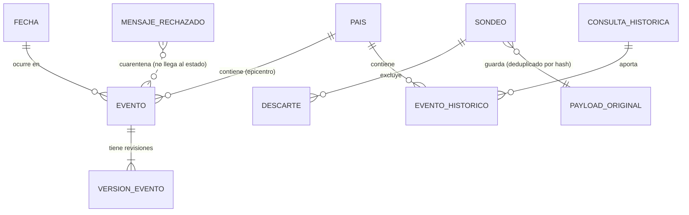

# Modelo de datos

El esquema físico real está en `backend/observatorio/migrations/` (`0001`–`0004`, única fuente; se aplican al arrancar el consumidor/productor con un candado de asesoramiento para evitar carreras).

## 1. Modelo conceptual



Entidades: **Evento** (terremoto identificado por `id` USGS, con su última versión), **Versión** (cada revisión inmutable), **País** (catálogo Natural Earth, dimensión conformada), **Fecha** (dimensión de calendario UTC), **Sondeo/Descarte/Payload** (trazabilidad del productor), **Consulta histórica/Evento histórico** (carga 2025), **Mensaje rechazado** (cuarentena).

Un evento puede no tener país (mar abierto): la relación País–Evento es opcional («Sin país asignado»).

## 2. Modelo lógico

| Tabla | Grano (una fila por…) | Clave primaria | Claves foráneas lógicas |
|---|---|---|---|
| `event_versions` | revisión de un evento | `(event_id, updated)` | `country_id → dim_country` |
| `current_events` | evento (última versión) | `event_id` | `country_id → dim_country` |
| `dim_country` | entidad `ADM0_A3` única | `country_id` | — |
| `dim_date` | fecha UTC con eventos | `date_key` | — |
| `poll_log` | sondeo del feed | `id` | `payload_hash → raw_payloads` |
| `poll_exclusions` | feature descartada en un sondeo | `id` | `poll_id → poll_log` (cascada) |
| `raw_payloads` | GeoJSON distinto (por SHA-256) | `payload_hash` | — |
| `extraction_queries` | consulta HTTP al FDSN | `id` | — |
| `historical_events` | evento de 2025 | `event_id` | `query_id → extraction_queries`, `country_id` |
| `quarantine_records` | mensaje Kafka rechazado | `(kafka_topic, kafka_partition, kafka_offset)` (único) | — |
| `replay.*` | copia aislada de `event_versions`, `current_events`, `quarantine_records` | igual que arriba | — |

Esquema en estrella para análisis: **hecho** `current_events` (medidas: `mag`, `depth`, `sig`, `nst`…; grano = evento) con dimensiones `dim_country` (país → subregión → continente) y `dim_date`. `event_versions` es la tabla de historia (auditable), nunca se agrega.

Decisiones de clave:

- **Clave natural `event_id`** (estable entre revisiones): USGS lo garantiza; no hace falta clave subrogada.
- **`(event_id, updated)`** identifica una versión; permite idempotencia (`ON CONFLICT`) y detectar conflictos de carga (mismo par, distinto hash → cuarentena).
- **`country_id = ADM0_A3`** y no `ISO_A3`: `ISO_A3` vale `-99` en varias entidades, `ADM0_A3` es único.
- **Estado actual materializado** (`current_events`) en vez de calcularlo con `max(updated)` en cada consulta: las agregaciones cuentan eventos, no mensajes, y no se infla por revisiones.

## 3. Modelo físico

Fragmento representativo (completo en las migraciones):

```sql
CREATE TABLE observatorio.current_events (
    event_id TEXT PRIMARY KEY,
    updated BIGINT NOT NULL,           -- ms epoch de la revisión: decide qué versión es la actual
    time_utc TIMESTAMPTZ,              -- instante del evento
    mag DOUBLE PRECISION,              -- NULL permitido: «ND», nunca 0
    depth DOUBLE PRECISION NOT NULL,
    longitude DOUBLE PRECISION NOT NULL,
    latitude DOUBLE PRECISION NOT NULL,
    country_id TEXT,                   -- NULL = «Sin país asignado»
    geo_ambiguous BOOLEAN NOT NULL DEFAULT FALSE,
    original_feature JSONB NOT NULL,   -- GeoJSON original sin alterar
    last_processed_at TIMESTAMPTZ NOT NULL DEFAULT clock_timestamp()
    -- … resto de campos USGS (ver diccionario-datos.md)
);
```

Upsert que mantiene el estado actual (una revisión antigua nunca lo sustituye):

```sql
INSERT INTO observatorio.current_events (...) VALUES (...)
ON CONFLICT (event_id) DO UPDATE SET ... 
WHERE EXCLUDED.updated > observatorio.current_events.updated;
```

### Índices y justificación

| Índice | Consulta que acelera |
|---|---|
| `current_events_pkey (event_id)` | upsert del consumidor y búsqueda por id |
| `idx_current_events_time_utc (time_utc)` | todos los filtros por periodo (`/api/eventos`, ventanas horarias) |
| `idx_current_events_country_time (country_id, time_utc)` | filtro por país + periodo; recuento por país |
| `idx_current_events_mag (mag)` | filtro `min_mag` |
| `idx_current_events_updated (updated)` | comparación de versiones |
| `idx_event_versions_time_utc`, `event_versions_pkey` | auditoría por periodo y detección de duplicados |
| `idx_historical_events_time (time_utc)` | media diaria 2025 de la comparación |
| `idx_poll_log_polled_at (polled_at)` | último sondeo para `/api/salud` y retención |

El efecto de los índices frente al recorrido secuencial se mide en [complejidad.md](complejidad.md). No se indexa `place` ni `original_feature`: no se filtra por ellos y encarecerían la escritura continua.

## 4. Aislamiento de la reproducción

El esquema `replay` replica las tres tablas de eventos (`CREATE TABLE … (LIKE observatorio.… INCLUDING ALL)`). El consumidor elige el esquema por *topic* (`earthquakes-replay` → `replay`); las dimensiones `dim_country`/`dim_date` se comparten. La API solo lee `replay` con `mode=replay`.
